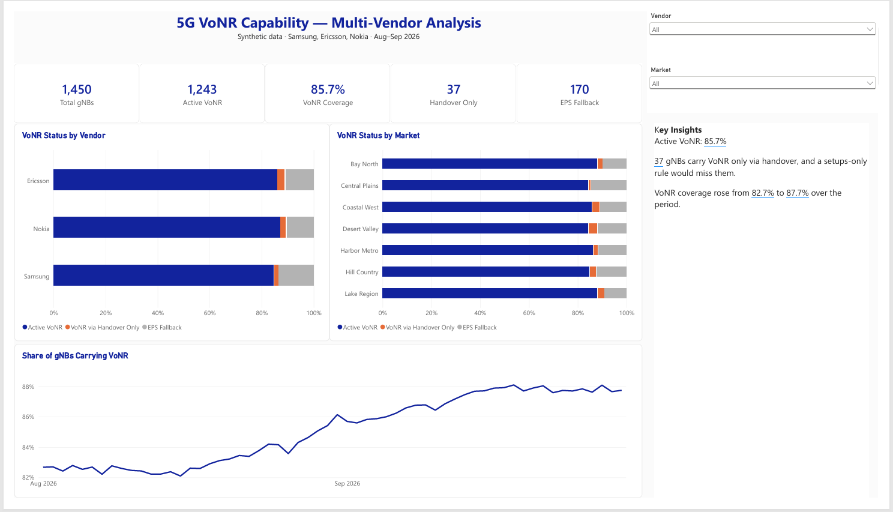
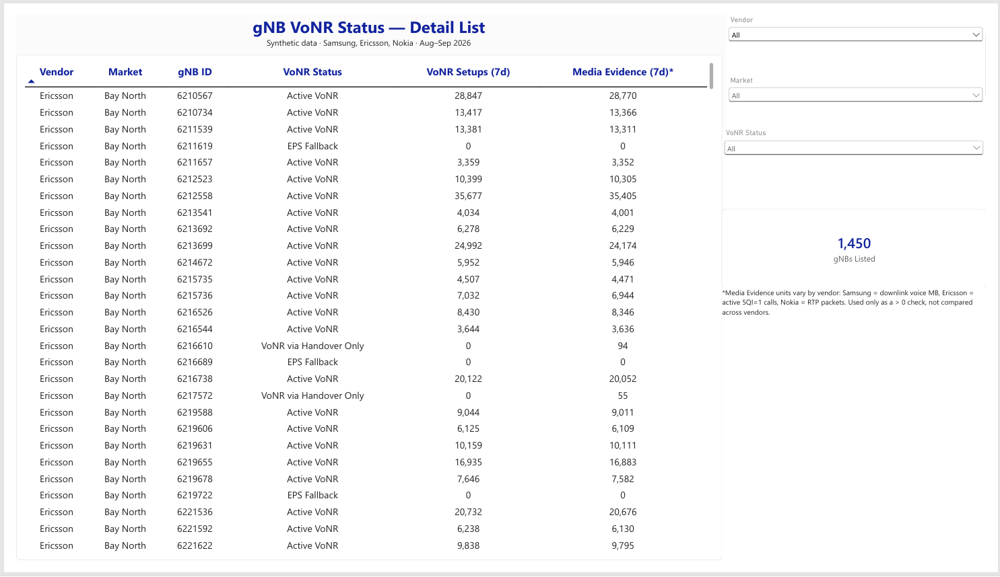
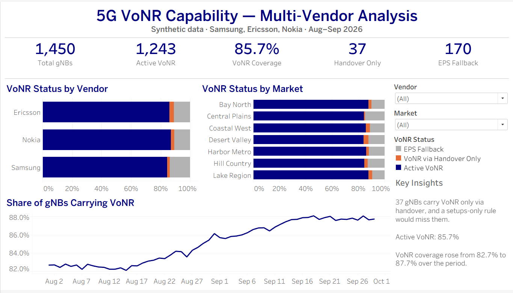
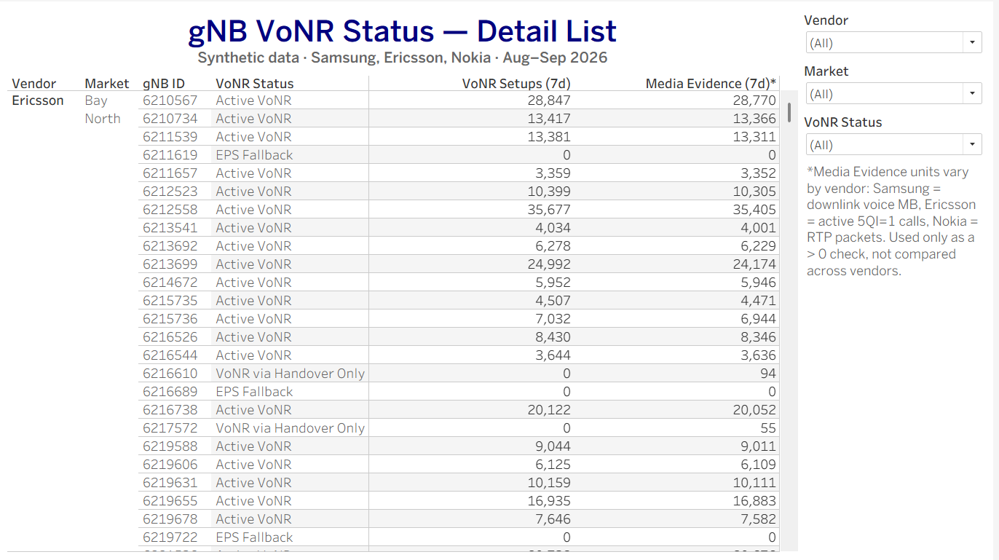

# 5G VoNR Capability — Multi-Vendor Analysis

**Which 5G gNodeBs are carrying native voice calls (VoNR), and which are still falling back to LTE?**

This project answers that question across three RAN vendors (Samsung, Ericsson, Nokia), whose performance exports name, format, and define their counters differently. The same classification is built three ways — **Python**, **Power BI (DAX)**, and **Tableau (LOD expressions)** — and all three return identical results.

🔗 **Live Tableau dashboard:** [5G VoNR Capability – Multi-Vendor Analysis](https://public.tableau.com/app/profile/marthony.rigor/viz/5GVoNRCapabilityMulti-VendorAnalysis/Overview)
📄 **Power BI version:** [`powerbi/VoNR_Capability_Dashboard.pbix`](powerbi/) (PDF export included)

> ⚠️ **All data in this repository is synthetic.** gNB IDs, markets, and values are generated by the included script. Counter names are vendor-flavored but generic; they are not any operator's internal KPI names.

---

## The Business Question

The project started with a real-world request: *"Give me a list of gNBs that are carrying 5G native calls, for all three vendors."*

It sounds simple, but there's no single "VoNR on/off" field to pull:

- **Configuration data** only shows *provisioned intent*. A feature flag can be on while the node still steers voice to LTE.
- **Each vendor reports differently.** Setup counters, payload counters, units, and date formats all vary.
- **The obvious rule is wrong.** "Has VoNR call setups → VoNR capable" misses nodes that carry VoNR calls only through **handover**: the call is set up elsewhere, then moves onto the node mid-call.

So the answer had to come from **performance telemetry**, normalized across vendors, with a rule that accounts for handovers.

---

## The Classification Rule

Each gNB is evaluated on full-day totals over the **last 7 days** of data:

| Status | Rule | Meaning |
|---|---|---|
| **Active VoNR** | VoNR setups > 0 | Natively sets up and carries 5G voice calls |
| **VoNR via Handover Only** | setups = 0 **and** media evidence > 0 | Carries VoNR calls handed over from other nodes |
| **EPS Fallback** | setups = 0 **and** media evidence = 0 | Voice is steered to LTE |

**Media evidence** is the vendor's proof that voice traffic actually crossed the 5G air interface:

| Vendor | Setup counter (synthetic) | Media evidence counter (synthetic) | Unit |
|---|---|---|---|
| Samsung | `SS_VoNR_ERABSetupAtt_5QI1` | `SS_VoNR_DLDataVol_5QI1_MB` | Downlink voice MB |
| Ericsson | `pmVoNrBearerSetupAtt5qi1` | `pmVoNrBearerActive5qi1` | Active 5QI=1 calls |
| Nokia | `VONR_SESSION_SETUP_ATT` | `VONR_RTP_PKT_RECEIVED` | RTP voice packets |

Because the units differ, media evidence is **only ever used as a `> 0` check**. It is never summed or compared across vendors.

Why a 7-day window instead of one day? A node with a short outage looks like EPS Fallback on a single day. Seven days of full-day totals separates real fallback from a temporary dip.

---

## Key Findings

| | Total gNBs | Active VoNR | Handover Only | EPS Fallback | VoNR Coverage |
|---|---|---|---|---|---|
| Ericsson | 750 | 644 | 23 | 83 | 85.9% |
| Nokia | 300 | 261 | 7 | 32 | 87.0% |
| Samsung | 400 | 338 | 7 | 55 | 84.5% |
| **All** | **1,450** | **1,243** | **37** | **170** | **85.7%** |

- **37 gNBs carry VoNR only via handover.** A setups-only rule would wrongly classify every one of them as EPS Fallback.
- **Samsung has the highest fallback share (13.8%)**, so it's the vendor with the most nodes still steering voice to LTE.
- **VoNR coverage rose from 82.7% to 87.7%** over the 60-day period as 77 nodes enabled VoNR between mid-August and mid-September.

---

## Dashboards

### Power BI




### Tableau ([live link](https://public.tableau.com/app/profile/marthony.rigor/viz/5GVoNRCapabilityMulti-VendorAnalysis/Overview))




Both versions include:
- **KPI cards:** total gNBs, Active VoNR, VoNR coverage %, Handover Only, EPS Fallback
- **100% stacked bars** of status by vendor and by market
- **Daily trend** of the share of gNBs carrying VoNR traffic
- **Key Insights** text that updates with the filters
- **gNB detail list** (the original request), filterable by vendor, market, and status

---

## How It Was Built

```
Raw vendor exports (3 schemas)
        │
        ├──► Power Query (M) ──► normalize ──► DAX classification ──► Power BI
        │
        └──► Python ──► fact_vonr_daily.csv ──► Tableau LOD classification ──► Tableau
```

Two pipelines were used on purpose, to show two ways of handling multi-vendor normalization:

**Power BI: normalization in Power Query (M)**
- Loaded the three raw vendor CSVs separately
- Renamed each vendor's counters to one shared schema (`date`, `gnb_id`, `market`, `vonr_setup_att`, `vonr_setup_fail`, `vonr_media_evidence`)
- Fixed vendor-specific quirks: three different date formats (`2026-08-01`, `08/01/2026`, `20260801`) and a `GNB` prefix on Ericsson node names
- Appended into one fact table, then **validated row counts per vendor against the source files** (this caught a duplicated append during development)
- Classified each gNB with a DAX calculated table (`SUMMARIZE` + `CALCULATE` + `SWITCH`), with measures for the KPIs, the trend, and the dynamic insights

**Tableau: classification with LOD expressions**
- Connected to the Python-normalized `fact_vonr_daily.csv`
- Per-gNB 7-day totals with `{ FIXED [gNB ID] : SUM(...) }`, so each node's status stays correct whatever filters are applied
- Regular `COUNTD` aggregations for the KPIs, so they *do* respond to filters
- 100% stacked bars via a Percent of Total table calculation

### Validation

| Implementation | Active VoNR | Handover Only | EPS Fallback |
|---|---|---|---|
| Python (`normalize_and_classify.py`) | 1,243 | 37 | 170 |
| Power BI (DAX) | 1,243 | 37 | 170 |
| Tableau (LOD) | 1,243 | 37 | 170 |

The Python script also checks the rule against the generator's hidden ground-truth labels: **100% accuracy**, versus 37 misclassifications for a setups-only rule.

---

## Repository Structure

```
├── README.md
├── data/
│   ├── samsung_pm_daily.csv        # raw vendor export (Samsung schema)
│   ├── ericsson_pm_daily.csv       # raw vendor export (Ericsson schema)
│   ├── nokia_pm_daily.csv          # raw vendor export (Nokia schema)
│   ├── counter_mapping.csv         # vendor counter → unified name
│   ├── fact_vonr_daily.csv         # normalized daily fact table (Python output)
│   ├── gnb_vonr_status.csv         # one row per gNB with its status
│   ├── dim_gnb.csv                 # gNB → vendor, market
│   └── ground_truth_profiles.csv   # generator's hidden labels (validation only)
├── generator/
│   └── generate_vonr_dataset.py    # synthetic data generator
├── scripts/
│   └── normalize_and_classify.py   # normalization + classification + validation
├── powerbi/
│   ├── VoNR_Capability_Dashboard.pbix
│   └── VoNR_Capability_Dashboard.pdf
├── tableau/
│   ├── VoNR_Capability_Dashboard.twbx  # packaged workbook (opens in Tableau Public/Desktop)
│   └── README.md                   # link to the Tableau Public workbook
└── images/                         # dashboard screenshots
```

---

## Running It

```bash
pip install pandas numpy

# 1. Generate the synthetic dataset (1,450 gNBs × 60 days, ~86.5K rows)
python generator/generate_vonr_dataset.py --out data --days 60 --seed 42

# 2. Normalize the three vendor exports, classify each gNB, and validate
python scripts/normalize_and_classify.py --data data --window 7
```

Open `powerbi/VoNR_Capability_Dashboard.pbix` in Power BI Desktop (free) to explore the Power BI version. For Tableau, use the live link above or open `tableau/VoNR_Capability_Dashboard.twbx` in Tableau Public (free).

### About the synthetic data
- **1,450 gNBs** across 7 fictional markets, one vendor per market
- **60 days** (Aug 1 – Sep 29, 2026), one row per gNB per day, full-day totals
- Built-in behaviors: weekday/weekend patterns, slight traffic growth, ~0.5% setup failure rates, a few multi-day outages, a small share of missing rows (export gaps), handover-only nodes, and 77 nodes that switch VoNR on mid-period

---

## Possible Extensions

- **Split EPS Fallback further** using IMS signaling (5QI=5): nodes with IMS signaling but no VoNR are SA nodes doing EPS Fallback, while nodes with neither are NSA or legacy anchors.
- **Alerting:** flag nodes that switch from Active VoNR to EPS Fallback between windows.
- **Quality layer:** add VoNR setup success rate and drop rate per vendor, once nodes are confirmed to be carrying VoNR.

---

## Tools

Python (pandas, NumPy) · Power BI (Power Query / M, DAX) · Tableau (LOD expressions, table calculations) · Git/GitHub

**Author:** Marthony Rigor · [LinkedIn](https://linkedin.com/in/marthony-rigor-b1714758) · [GitHub](https://github.com/mgrigor)
